<div align="center">

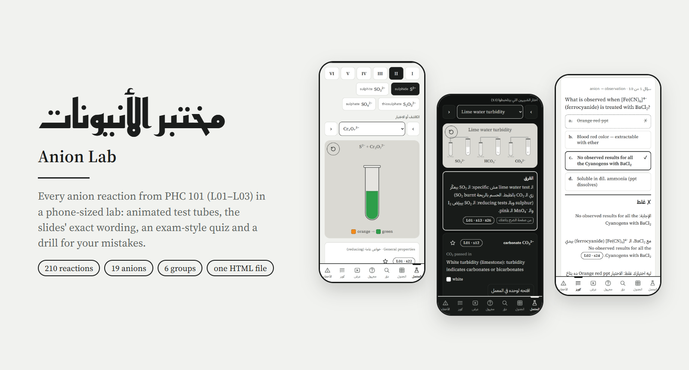

<br>

**A phone-sized chemistry lab for every anion reaction in PHC 101 (Pharmaceutical Analytical Chemistry I, L01–L03).**
Pick an anion and a reagent and watch the test tube react, with the slides' exact wording next to it.

[**Open the live site →**](https://anion-lab.vercel.app) &nbsp;·&nbsp; [Releases](../../releases) &nbsp;·&nbsp; [How it's built](#how-its-built)


</div>

---

<div align="center">
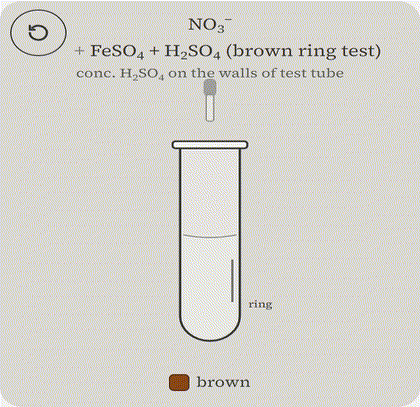
<br><sub>CO₃²⁻ + dil. HCl fizzes · S²⁻ turns Cr₂O₇²⁻ from orange to green · NO₃⁻ forms the brown ring</sub>
</div>

## Why it exists

Exams in this course are marked against the doctor's slides. One wrong colour word ("yellow" where the slide says "canary yellow") costs marks. Anion Lab turns the three anion lectures into something you can practise with on a phone:

- **Every observation, colour word and equation is copied from the slides**, with its slide reference (`L02 · s14`) on every card.
- **Slide mistakes stay as they are and get flagged.** Where an equation on a slide is wrong, the page shows the slide's version next to the corrected one with a ⚠️. Anything that isn't on the slides is marked «زيادة للفهم — مش في السلايدز».
- **It runs on the phone you study on.** It's one self-contained HTML file with no install and no account. Progress stays on the device.

## What's inside

<table>
<tr>
<td width="50%" valign="top">
<picture><source media="(prefers-color-scheme: dark)" srcset="docs/media/lab-dark.png">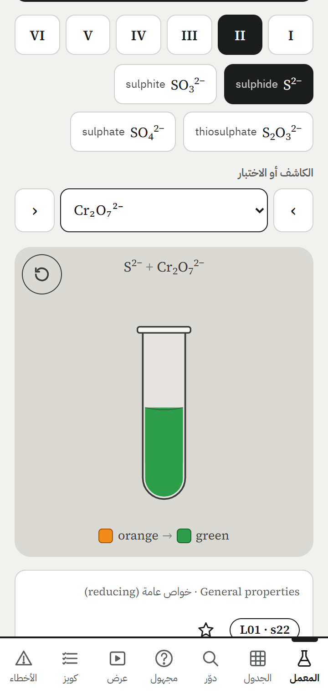</picture>
<h3>المعمل · The lab</h3>
Choose a group, an anion and a reagent (and the condition, if the slide gives more than one). A test tube plays the reaction: drops fall, precipitates settle, gas bubbles, fumes rise, layers separate, rings form. A colour strip and the slide's own words sit under it, along with a «ليه بيحصل كده؟» explanation where one exists.
</td>
<td width="50%" valign="top">
<picture><source media="(prefers-color-scheme: dark)" srcset="docs/media/compare-dark.png">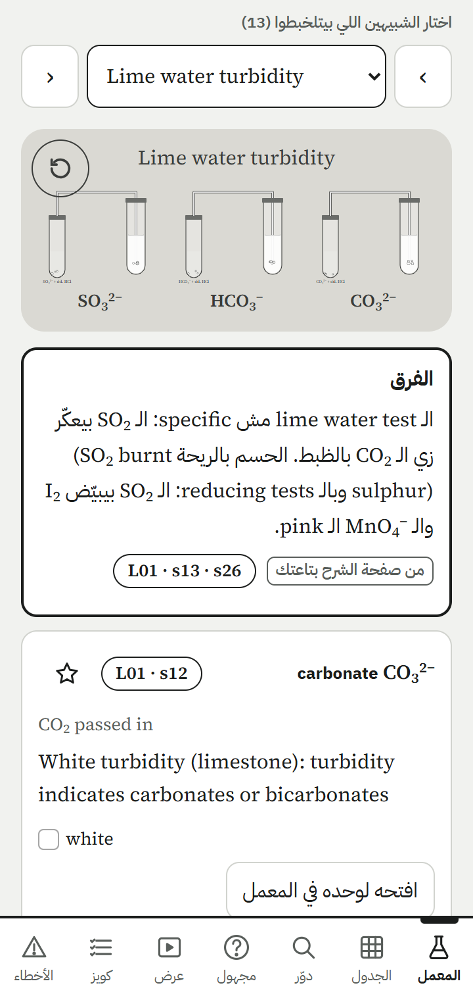</picture>
<h3>قارن الشبيهين · Compare look-alikes</h3>
13 sets of reactions that are easy to confuse (for example lime-water turbidity from CO₂ vs SO₂) play side by side, each with the one difference that tells them apart.
</td>
</tr>
<tr>
<td valign="top">
<picture><source media="(prefers-color-scheme: dark)" srcset="docs/media/grid-dark.png">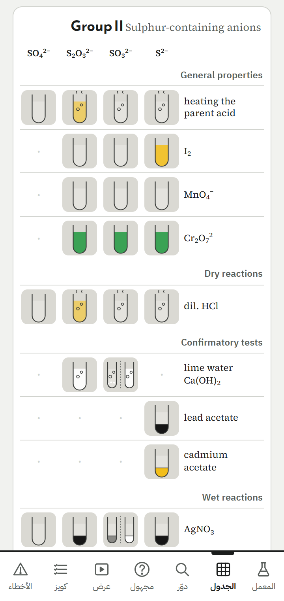</picture>
<h3>الجدول · The grid</h3>
Every anion × every test on one screen, each cell drawn as the tube you'd see. A «حفظك» mode turns it into a mastery map fed by the quiz and the unknown samples.
</td>
<td valign="top">
<picture><source media="(prefers-color-scheme: dark)" srcset="docs/media/find-dark.png">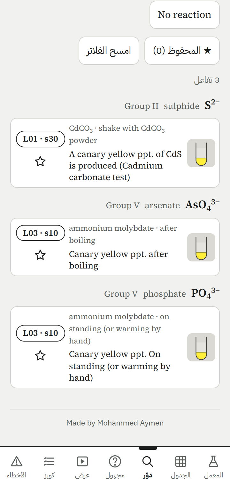</picture>
<h3>دوّر · Find by what you saw</h3>
Search any word, or tap a colour ("canary yellow") or an effect (gas, fumes, ring, flame…) to list every reaction that gives it, grouped by anion, with slide numbers. ★ saves a reaction to your own list.
</td>
</tr>
<tr>
<td valign="top">
<picture><source media="(prefers-color-scheme: dark)" srcset="docs/media/quiz-dark.png">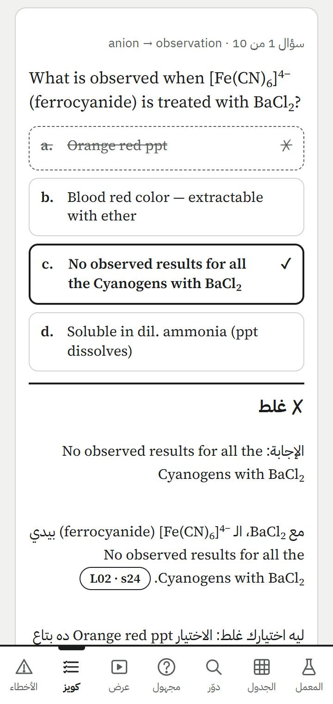</picture>
<h3>كويز · Exam-style quiz</h3>
One question at a time, in the forms the exam uses: MCQ in both directions, true/false with correction, matching and complete-the-sentence. Wrong options come from the same group first, so they look like real exam distractors. A «راجع غلطاتي» drill re-asks each mistake in a new form until you get it right twice in a row.
</td>
<td valign="top">
<picture><source media="(prefers-color-scheme: dark)" srcset="docs/media/unknown-dark.png">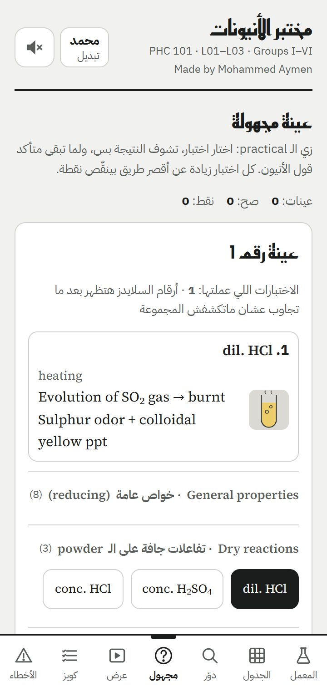</picture>
<h3>مجهول · Unknown sample</h3>
Like the practical: run tests on a hidden anion and see only the results, then name it. Points drop for every test beyond the shortest path, and the feedback shows that path.
</td>
</tr>
<tr>
<td valign="top">
<picture><source media="(prefers-color-scheme: dark)" srcset="docs/media/errors-dark.png">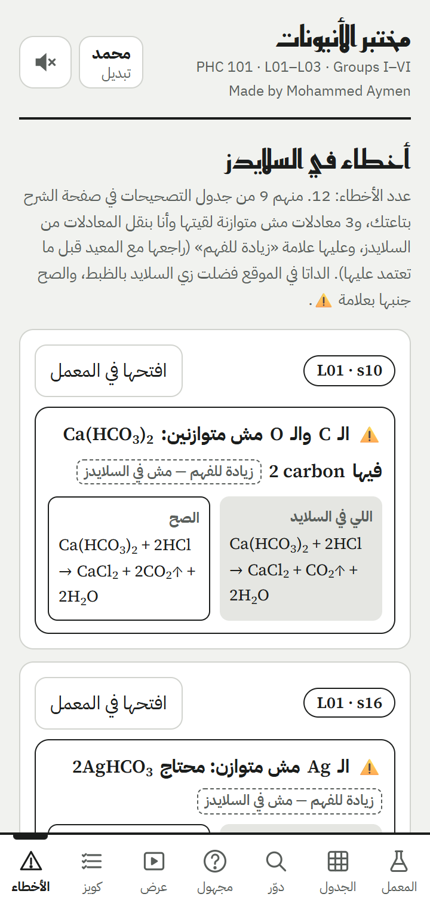</picture>
<h3>الأخطاء · Slide errors</h3>
All 12 known slide errors in one list, in slide order: the slide's version next to the corrected one.
</td>
<td valign="top">
<picture><source media="(prefers-color-scheme: dark)" srcset="docs/media/profiles-dark.png">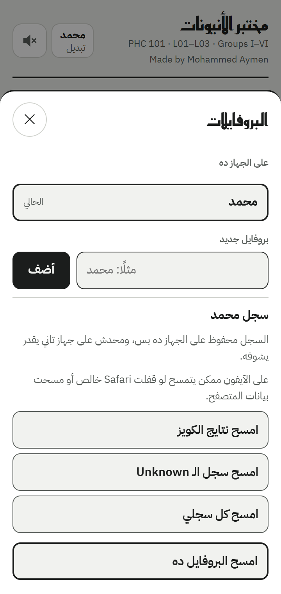</picture>
<h3>البروفايلات · Profiles on this device</h3>
Several people can study on one phone, each with their own progress, ★ list and sound settings, plus in-page confirmations for clearing history. Everything lives in this browser's storage and never leaves the device.
</td>
</tr>
</table>

There's also a **عرض (Play)** mode that runs a whole group like a video, at 0.5×–2× speed. The page follows the phone's light or dark theme. The UI chrome is ink on paper with no colour at all, so the only colours on screen are the reaction colours you need to remember.

## Lab sounds

Off by default and turned on with the speaker in the top bar. Every sound is **synthesized live with the Web Audio API**; the repo has no audio files.

| Sound | Plays when | How it's made |
|---|---|---|
| drip | a drop of reagent reaches the tube | one upward-gliding sine "plink" with a small body |
| fizz | gas or bubbles | ~14 small bubble grains a second over a soft pink-noise bed |
| boil | the tube is heated | fewer, larger, lower bubbles over a brown-noise rumble |
| hiss | fumes rise | low-Q band-passed pink noise, swelling in slowly |
| clink | a layer is shaken | three slightly inharmonic glass partials |
| trickle | acid runs down the wall (ring test) | a steady stream of small bubbles |
| roar | the flame test | low-passed brown and pink noise with a slow flutter |
| right / wrong | quiz answers | soft marimba-like notes |

The bubbles follow how real bubbles ring: a short sine that rises in pitch and decays (Minnaert resonance; van den Doel, *Physically based models for liquid sounds*, 2005). All cues share one master chain: a high-shelf cut, a short generated room reverb, then a soft limiter. Every start and stop is ramped, so nothing clicks. On iPhone, audio starts only from a real tap and uses `navigator.audioSession = "playback"` so it plays even with the silent switch on, where the browser supports it.

[`anionlab/sound-metrics.mjs`](anionlab/sound-metrics.mjs) renders each cue offline and checks it. The targets: under 5 % of energy above 6 kHz, a spectral centroid under 2.5 kHz, each cue's loudness within ±3 dB of the others, and no sample-to-sample jump over 0.01 at the start or at a stop. The preview page [`anionlab/sound-check.html`](anionlab/sound-check.html) plays the old and new engines side by side.

## How it's built

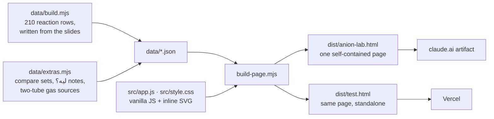

- **No framework and no runtime dependencies.** The page is plain JavaScript inside one IIFE, CSS custom properties for both themes, and SVG scenes animated with CSS transitions scheduled on a timeline (`mountScene()`).
- **The data is frozen.** [`check_data.py`](check_data.py) and [`anionlab/check_data.py`](anionlab/check_data.py) compare the JSON inside any built page with a baseline and fail on a single changed character, so no feature can quietly reword a reaction.
- **Mobile first:** 360 px layout, 44 px tap targets, safe-area insets, `prefers-reduced-motion` (scenes jump to their end and stay silent), and a page that still works when storage or audio is blocked.

## Tests

| Suite | What it covers | Runs |
|---|---|---|
| [`tests/acceptance.mjs`](tests/acceptance.mjs) | slide-exact colours in every scene, compare, find, ★, two-tube gas, mastery, ليه؟ tags | 18 tests + 11 reduced-motion reruns |
| [`tests/update.mjs`](tests/update.mjs) | profiles, delete history, credit, errors list, distractors, drill, sounds | 12 tests × light / dark / reduced motion |
| [`anionlab/tests.mjs`](anionlab/tests.mjs) | T1–T15: profiles, migration, storage blocked, every delete path, focus, credit above the nav, 50-question distractor audit per group, drill, sound timing, iPhone unlock rules, broken-audio fallbacks, the engine in the page | 63 runs |

All suites drive the real page in Chrome with `playwright-core`, at 360 × 800, and fail on any console error. The sound tests click the speaker for real, with no autoplay flag.

## Run it locally

```sh
npm install                      # playwright-core only
npm run build                    # data → dist/anion-lab.html + dist/test.html
npm test                         # acceptance suite
node tests/update.mjs light      # also: dark, reduce
node anionlab/tests.mjs dist/test.html
node anionlab/sound-metrics.mjs  # sound targets, before/after table
uv run --no-project python -I check_data.py dist/anion-lab.html
```

Open `dist/test.html` in a browser to use the page. To deploy, copy it to `site/anion-lab/index.html` and run `npx vercel@63.1.2 deploy --prod --yes` from that folder.

<details>
<summary><b>Repository layout</b></summary>

| Path | What it is |
|---|---|
| `data/build.mjs` | Every reaction row, written from the slides → `data/reactions.json`, `colors.json`, `anions.json` |
| `data/extras.mjs` | Two-tube gas sources, look-alike compare sets, «ليه بيحصل كده؟» notes (tagged slide / doc / extra) |
| `src/app.js`, `src/style.css` | The page |
| `build-page.mjs` | Inlines data + CSS + JS into one file |
| `anionlab/` | The update prompts (`prompt-*.md`), their rules (`RULES.md`), patch scripts, the T1–T15 suite, the sound engine and its metrics |
| `tests/` | The acceptance suites |
| `tools/` | Dev helpers: screenshots, quiz checker, a11y pass, README media (`readme-media.mjs`, `readme-art.mjs`) |
| `docs/` | README images and the GitHub social preview |
| `NOTES.md`, `PLAN-v3.md` | Working notes: sources, slide errors, decisions |

The slide PDFs, slide images and text dumps are kept out of the repo on purpose.
</details>

## Releases

Each [release](../../releases) carries the single-file page for that version, so any version can be opened offline.

| Version | Highlights |
|---|---|
| **v8.0.0** | profile-sheet fixes, 2–3 option distractors with per-group audit, the «راجع غلطاتي» drill, a new synthesized sound engine with iPhone-safe unlock |
| v3.0.0 | profiles on the device, delete history, credit, one 12-entry errors list, first lab sounds |
| v2.0.0 | compare look-alikes, find view with ★, more quiz types, mastery map, two-tube gas scenes, ليه؟ notes |

---

<div align="center">
<sub>Made by <b>Mohammed Aymen</b> · built with <a href="https://claude.com/claude-code">Claude Code</a> · for PHC 101 students</sub>
</div>
